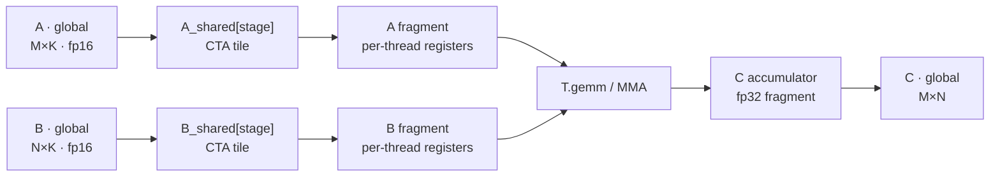
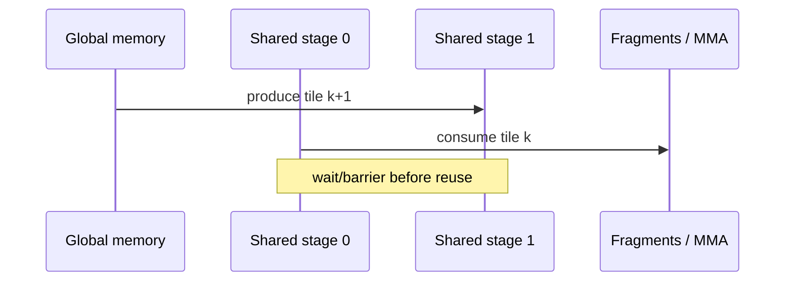

# Writing TileLang Design Documents

Create a document a person can review without reading the implementation first.
Explain the problem, the selected design, why it should work, and what evidence
supports it. Use a professional, approachable tone and visuals that make the
kernel's execution and memory behavior easier to understand.

This document is separate from the agent's operational files. `docs/plan.md`,
candidate ledgers, benchmark CSVs, raw logs, worker assignments, and command
checklists drive execution. The design document communicates stable intent,
decisions, implementation status, results, and unresolved risks. Link useful
artifacts rather than copying the work log into the document.

## Establish the document state

At the top, state:

- **Status:** Proposed, in implementation, implemented, or validated.
- **Scope:** operation, supported shapes/dtypes, forward/backward coverage, and
  important exclusions.
- **Target:** GPU architecture, TileLang version, and relevant backend.
- **Evidence date:** when implementation and measurements were last checked.

Use future tense for proposed behavior and past or present tense for observed
behavior. Never present a planned lowering, speedup, or resource count as an
observed result. When updating the document after implementation, replace stale
predictions with the result and retain only tradeoffs that still explain the
final design.

## Write for a human reviewer

Lead with a short overview: the user-visible problem, the implementation idea,
and the expected or observed outcome. Define TileLang or GPU-specific terms on
first use. Explain the design from operation semantics to grid/work partition,
memory movement, compute, synchronization, and output.

Keep paragraphs connected and use tables for contracts or comparisons. Under
every figure, add a one-sentence takeaway. Label each visual as
**conceptual**, **authored-model**, **compiler-derived**, or
**runtime-measured**, and name the specialization it represents. An
authored-model visual is machine-readable design evidence such as TileFoundry
HIR or static analysis; it is still distinct from emitted code and observed
runtime. Prefer two useful visuals over a gallery of raw tool output.

Start from [design-doc-template.md](references/design-doc-template.md), adapting
its sections to the design. Omit empty sections.

## Choose Markdown or interactive HTML

Use Markdown for an ordinary proposal or implementation report. It is easy to
review in source control, supports Mermaid in compatible renderers, and keeps
the technical narrative searchable.

Use interactive HTML when interaction answers a review question: comparing
proposed and observed behavior, filtering conceptual/authored-model/compiler/
runtime evidence, expanding detailed artifacts, or navigating several large
figures. Do not add interaction only as decoration. Start from
[interactive-design-doc-template.html](references/interactive-design-doc-template.html)
and replace its placeholders with the design's content and relative artifact
paths.

Keep the HTML usable without network access. Export Mermaid diagrams to local
SVG when the browser cannot render Mermaid itself. Preserve headings, captions,
alt text, visible units, keyboard-operable controls, and a print layout. Put the
main conclusion in normal document text so it remains visible when JavaScript
is unavailable.

## Choose visuals by review question

| Review question | Human-friendly visual | Supporting evidence |
| --- | --- | --- |
| What does the kernel compute? | Operation/dataflow diagram | Reference and implementation source |
| What model region, topology, and placement were authored? | TileFoundry HIR graph or focused viewer capture | Authored module, selector, target, and dimension bindings |
| How is work divided? | Grid → CTA → warp-group/warp → lane diagram | Specialized TIR and launch code |
| Where does each tensor live and move? | Global/shared/fragment memory-flow diagram | Specialized TIR and generated source |
| How does pipelining work? | Copy/compute/wait stage diagram | Pipeline annotations and lowering |
| Which thread owns each element? | TileLang layout SVG | Inferred or explicit layout mapping |
| When may buffers be reused? | Tensor-lifetime SVG | Named compiler boundary and allocator report |
| What did the compiler change? | Selected Lower Trace or Pass Visualizer view | Exact compiled specialization |
| What overlaps at runtime? | Cropped Perfetto or Nsight timeline | Captured execution trace |
| Did the design improve results? | Small comparison table or chart | Reproduced correctness/performance data |

A static analyzer result is an estimate. A compiler event index is an ordering
axis. A GPU trace is measured time. Keep these evidence types in separate
figures and describe their limits in the caption.

When a design starts from TileFoundry, use the
[TileFoundry workflow](../../designing-with-tilefoundry/SKILL.md) to capture the
authored HIR graph and static analysis. Use the HIR viewer interactively while
exploring large function trees, placement, and dependencies. For durable
review, include a focused static export or screenshot plus the DOT source,
analysis report, and exact viewer command. The viewer runs through a local
server and cached browser assets, so do not present it as a self-contained HTML
artifact. Pair it with a specialized TileLang TIR or generated-code figure to
show whether the planned mapping actually materialized.

## Draw the implementation overview

Adapt this Mermaid pattern to the real tensor names, shapes, and scopes:



Solid arrows show data dependencies. Use dashed arrows for synchronization or
ownership handoffs and explain them in the caption. If asynchronous copies or
warp specialization are only proposed, label the diagram accordingly.

For a pipelined loop, show logical dependencies and buffer versions. Do not use
arrow spacing as a claim about elapsed time:



## Add compiler and runtime evidence selectively

For explicit or inferred thread/data mappings, use `tilelang.tools.plot_layout`
or the layout-visualization pass. For the full pipeline, use IR Lower Trace
HTML. For a focused CUDA structure tree, use Pass Visualizer. Exact current
commands are in
[compiler-tools.md](../debugging-tilelang-programs/references/compiler-tools.md).
IR Lower Trace supersedes the legacy `TILELANG_PASS_DIFF` workflow.

For compiler-derived lifetimes, follow
[buffer-lifetime-analysis.md](../debugging-tilelang-programs/references/buffer-lifetime-analysis.md)
and render the reviewed data with the standard-library helper:

```bash
python skills/tilelang/writing-tilelang-design-docs/scripts/render_tensor_lifetimes.py \
  lifetimes.json --output lifetimes.svg
```

The renderer does not infer intervals. Its input format is documented in
[tensor-lifetime-format.md](references/tensor-lifetime-format.md).

For measured timelines, use the
[PyTorch profiling skill](../torch-profiling-tilelang-programs/SKILL.md), Nsight
Systems, or the optional
[IKET workflow](../profiling-tilelang-programs/references/iket-profiling.md).
Include a focused screenshot or trace link and explain the observed interval;
do not make the reader search a full trace for the claimed behavior.

## Handle dependencies and artifacts

Prefer Mermaid and SVG because they remain legible in review tools. Layout
image output requires Matplotlib; text layout output does not. IKET requires its
external profiler/runtime. Follow the linked dependency gates and ask before
installing an optional package into the user's environment.

Store authored diagrams and their source beside the design document. Keep
generated input data beside charts, use stable relative links, and give files
descriptive names such as `memory-flow.svg`, `smem-lifetimes.svg`, and
`lowering-layout-inference.html`.
