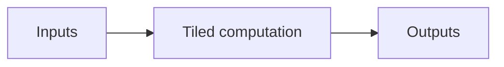

# TileLang Design Document Template

Use this as a writing scaffold. Replace prompts with concrete prose and omit
sections that do not help the review. A proposal describes expected behavior;
an implementation report describes behavior supported by current evidence.
For a document that needs evidence filtering or collapsible detail, use the
[interactive HTML template](interactive-design-doc-template.html) instead and
retain this section order.

````markdown
# <Operation or kernel design>

> **Status:** Proposed | In implementation | Implemented | Validated<br>
> **Scope:** <supported operation, shapes, dtypes, forward/backward><br>
> **Target:** <GPU architecture, TileLang version, backend><br>
> **Evidence date:** <YYYY-MM-DD>

## Overview

<Explain the problem, the selected approach, and the expected or observed
outcome in two or three short paragraphs. Give the reader the main result
before implementation detail.>

## Requirements and constraints

| Area | Requirement |
| --- | --- |
| Inputs/outputs | <shapes, dtypes, strides, ownership, mutation> |
| Numerical behavior | <reference semantics and tolerance> |
| Target | <architecture and required features> |
| Performance | <workloads and objective, when defined> |

## Design

### Operation and data flow

<Describe the mathematical stages and fusion boundary.>



**Figure 1 — Conceptual.** <State the single point the reviewer should learn.>

### Execution mapping

<Explain grid dimensions, work per cooperative thread array (CTA), threads or
warp groups, tail handling, and specialization. Add a hierarchy diagram when
roles are not obvious.>

### Memory organization

| Tensor/buffer | Shape and dtype | Scope | Producer → consumer | Reason |
| --- | --- | --- | --- | --- |
| <name> | <tile shape, dtype> | <global/shared/fragment/local> | <stages> | <reuse/layout/accumulation> |

<Add a memory-flow or lifetime figure when reuse, aliasing, or asynchronous
completion is central to the design.>

### Pipeline and synchronization

<Explain stage count, copy/compute overlap, barriers or waits, buffer reuse, and
producer/consumer ownership. State whether this is conceptual, authored-model,
compiler-derived, or runtime-observed.>

## Interface and integration

<Describe callable inputs/outputs, dynamic symbols, output allocation, saved
state for backward, stream behavior, and integration constraints.>

## Tradeoffs and alternatives

<Explain the material alternatives considered and why the selected design fits
the stated constraints. Use a comparison table when several options matter.>

## Validation and results

| Claim | Status | Evidence | Artifact |
| --- | --- | --- | --- |
| Numerical agreement | <planned/passed/failed> | <cases and tolerance> | <link> |
| Authored model | <planned/checked/failed> | <HIR selector, target, dimensions, and static finding> | <link> |
| Intended lowering | <planned/observed/not observed> | <target and finding> | <link> |
| Resource use | <estimated/measured/unavailable> | <shared bytes, registers, spills> | <link> |
| Performance | <estimated/measured/unavailable> | <scope, cases, units, variation> | <link> |

<Explain the result and its practical meaning. A proposed document should state
the validation approach without implying that commands have already passed.>

## Risks and open questions

- <Correctness, portability, resource, maintenance, or measurement risk.>
- <Question that still needs compiler or runtime evidence.>

## References

- <Implementation and reference paths>
- <Relevant compiler reports, traces, or external specifications>
````

## Presentation checks

- The overview can be understood without opening source code.
- Proposed and observed behavior are visibly different.
- Every diagram has a caption, evidence level, specialization or model selector,
  and takeaway.
- Tensor names, shapes, dtypes, scopes, and ownership match the implementation.
- Numbers include units and identify whether they are estimates or measurements.
- Compiler event order and runtime time are not combined.
- Raw logs and operational task management remain linked artifacts rather than
  the narrative of the document.
